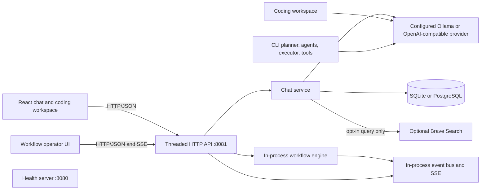
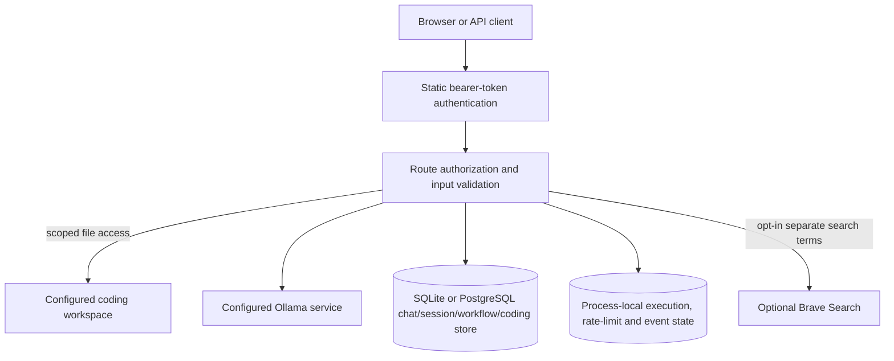

# Architecture

This is the current repository architecture, not the proposed future service
topology. It is based on the Python source, API routes, frontend, tests, and
deployment examples.

The implementation is the foundation for the
[AI Brain Master Architecture](./AI_BRAIN_MASTER_ARCHITECTURE.md). It is not
a claim that the full twelve-system Cognitive Core or distributed multi-agent
runtime exists.

## System context

## Request and workflow paths

Chat requests enter `ChatService`, which validates the caller/conversation,
selects the configured provider and model, and persists the exchange through
`ChatStore`. Optional web search requires a separate query and server-side
Brave key. API chat does not currently invoke the CLI RAG path.

Chat mode now also enters `UnifiedAgentRuntime`, which is shared by the HTTP
chat path and terminal CLI. The runtime creates conversation-scoped memory,
resolves context, runs `ToolPlanner`, and dispatches through `Executor`,
`ActionRegistry`, and registered tools. Deterministic TimeIntent and
MathIntent requests do not call the provider. Normal chat requests use
ChatHandler and the selected provider/model. Coding mode remains separate and
preserves its CodingAgent workspace behavior.

TimeIntent resolves IANA locations through `zoneinfo` and passes a timezone
to TimeTool. MathIntent preserves arithmetic/comparison expressions and
CalculatorTool evaluates them through a bounded AST. Freshness-sensitive chat
questions automatically use configured Brave Search; unavailable search
returns an explicit limitation instead of inventing current facts.

Timezone resolution recognizes maintainable city/country aliases and direct
IANA identifiers. Ambiguous countries such as Australia remain deterministic
clarification requests rather than provider guesses.

`ContextResolver` now tracks `last_action`, `last_location`, and `last_tool`.
Elliptical time follow-ups such as "and India", "what about London", and
"use tool" resolve against the recent current-time action only. Unrelated
questions clear that action context and do not inherit TimeTool routing.

The workflow engine validates dependencies and executes ready DAG nodes with
bounded thread concurrency. The REST workflow service constructs only a
restricted set of node types and persists definitions/run snapshots in
`ChatStore`; Python callers can also construct workflow objects with callables,
which are not persisted. Run execution and event subscribers remain local to
the API process.

The planner/executor path is a separate framework seam: intent matching
produces plans, and the executor dispatches actions. It should not be confused
with the REST workflow service or with an autonomous, model-driven agent.

ExecutionPlan lifecycle is validated by `PlanningGraph` before action
dispatch. Validation rejects duplicate/empty IDs, self/unknown dependencies,
and cycles. Execution is sequential and fail-fast: a failure marks that step
FAILED, all remaining steps SKIPPED, and the plan FAILED. Completed plans
cannot execute again; failed or partially executed plans cannot replay
completed side-effecting steps. Exact `{{previous}}` references preserve
Python value types; whitespace variants are equivalent. Interpolated
references are stringified.

## Persistence and trust boundaries

External model output, prior conversation/session text, retrieved search
results, and files selected for model context must be treated as untrusted
input. The current coding agent validates generated patches and confines
paths, but does not provide an execution sandbox.

## Key modules

| Concern | Implementation |
| --- | --- |
| API bootstrap and routes | `app/api/server_main.py`, `app/api/http_server.py` |
| Chat persistence and behavior | `app/chat/store.py`, `app/chat/service.py` |
| Coding assistant | `app/agents/coding_agent.py` |
| Planning/execution | `app/planner/`, `app/executor/` |
| Workflow runtime | `app/workflows/` |
| Memory and RAG | `app/memory/` |
| Providers | `app/providers/` |
| Plugins and MCP | `app/plugins/`, `app/mcp/` |
| Event transport and health | `app/realtime/`, `app/health/` |
| Web UI | `frontend/chat-ui/` |

See [API and Developer Guide](./API_AND_DEVELOPER_GUIDE.md) and
[Deployment and Operations](./DEPLOYMENT_AND_OPERATIONS.md) for operational
details.
